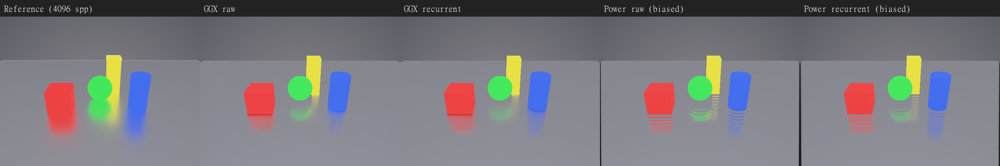
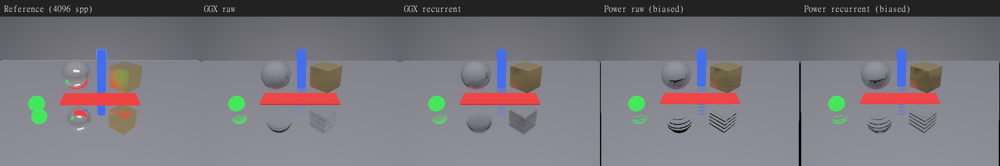
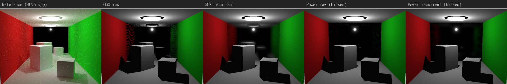

# Captured SSR comparisons

12 scenes, seed 1, 64 completed frames, 4096-sample path-traced references. Actual adapter provenance is retained in [capture records](data/SSR-EXPERIMENTS-CAPTURES.json).

Positive values mean the candidate scores higher than its matched control. For feature-removal comparisons, a negative value measures a conditional penalty: restoring that feature provides the opposite signed benefit within this full pipeline. The capped march uses uncapped linear marching as its control; both disable Hi-Z. These deltas are not additive or predictions for standalone PRs.

| Renderer                     | Matched control          | Mean PSNR change (dB) | Identical scenes |
| ---------------------------- | ------------------------ | --------------------: | ---------------: |
| three-pr72-ggx-raw           | three-dev                |                0.1643 |             0/12 |
| three-pr72-ggx-recurrent     | three-pr72-ggx-raw       |                0.1907 |             0/12 |
| three-pr72-power-raw         | three-pr72-ggx-raw       |               -1.5922 |             0/12 |
| three-pr72-power-recurrent   | three-pr72-ggx-recurrent |               -1.5079 |             0/12 |
| three-dev-mirror             | three-dev                |               -0.0578 |             0/12 |
| three-dev-pr28-normal-bias   | three-dev                |               -0.0062 |             0/12 |
| three-dev-pr29-ray-guard     | three-dev                |               -0.0000 |            11/12 |
| three-dev-pr30-sampling-docs | three-dev                |                0.0000 |            12/12 |
| three-dev-pr32-dielectric    | three-dev-mirror         |                0.0159 |             0/12 |
| three-dev-pr33-back-depth    | three-dev                |               -0.2844 |             0/12 |
| three-dev-pr34-radiance-hook | three-dev                |                0.0000 |            12/12 |
| three-ssr-full               | three-dev                |                6.6659 |             0/12 |
| three-ssr-additive-env       | three-ssr-full           |              -12.1984 |             2/12 |
| three-ssr-capped-march       | three-ssr-no-hiz         |               -1.5550 |             0/12 |
| three-ssr-no-hiz             | three-ssr-full           |               -0.1412 |             0/12 |
| three-ssr-distance-fade      | three-ssr-full           |               -0.9391 |             0/12 |
| three-ssr-no-back-depth      | three-ssr-full           |               -0.6257 |             0/12 |
| three-ssr-no-filter          | three-ssr-full           |               -0.4663 |             0/12 |
| three-ssr-no-hit-specular    | three-ssr-full           |               -0.3810 |             0/12 |
| three-ssr-biased-lobe        | three-ssr-full           |               -0.1941 |             0/12 |
| three-ssr-short-rays         | three-ssr-full           |               -0.0326 |             0/12 |

PR #32 improves the intended dielectric diagnostic by 0.9581 dB but changes the wall scene by -1.3725 dB; its mean is 0.0159 dB. Treat it as a targeted flag-behavior fix with composition regressions, not a broad fidelity improvement. Standalone PR #33 in GGX mode averages -0.2844 dB; this suite supports keeping it experimental. Its effect is distinct from removing back depth from the full pipeline. The mirror-control row compares sampling modes and is not an independent PR result.

PR #30 changes documentation only. PR #34 adds an unused radiance API in the stock-provider capture; a radiance-producing provider is required to realize integration gains. Compare PR #32 with the mirror control, since it does not alter stochastic GGX. No throughput claim is inferred from image quality.

Inspect scene-level scores and difference images in the viewer before deciding on a merge. Full-frame RGB8 PSNR can hide local regressions; this is one GPU, one static pose and one seed per scene. [Per-scene scores](data/SSR-EXPERIMENTS.json) and [renderer definitions](SSR-EXPERIMENTS.md) retain the matched controls and source pins.

## Experimental power-lobe results

The opt-in PR #72 group is pinned to fe44dbcdb0cc6a9ffe119b17f6d1e9f305c5ce34 and shares its runtime/composition settings. Power minus matched GGX averages -1.5922 dB raw and -1.5079 dB with the existing recurrent filter. Filter-only changes, holding the estimator fixed, average 0.1907 dB for GGX and 0.2750 dB for power. These are separate comparisons; no new denoiser was introduced. The GGX raw versus older three-dev row includes runtime/composition changes and is not a matched estimator comparison. Power is deliberately biased; these full-frame static scores establish neither unbiased energy nor motion/performance superiority.

Columns below are reference, GGX raw, GGX recurrent, power raw and power recurrent. Power's roughness diagnostic shows structured bands/speckles; recurrent filtering smooths them while softening detail. The Cornell images also expose the common missing diffuse indirect lighting with SSGI disabled; this is not a measure of SSR alone over the whole image.

