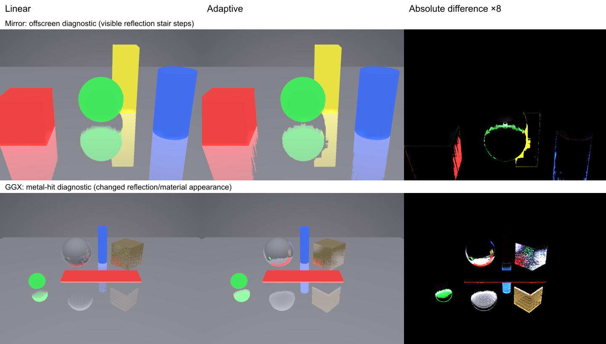

# Measured Hi-Z traversal quality

Nine diagnostic scenes at 480×360, scene quality 0.5, requested binaryRefine=true, seed 1, 64 completed frames per fresh renderer, physical NVIDIA GeForce RTX 3060 Ti, Chrome 148.0.7778.97. Fork commit `fac1b2050ae4cd5a59b890a878e69e616c2782f7`; the original suite core remains at `83c310af727`. Captures and throughput use this same browser; separate Three.js demo benchmarks used Chrome 155 and are not directly interchangeable.

| Variant                | Mean pathtrace PSNR (dB) | Change vs matching linear (dB) | Exact PNG matches |
| ---------------------- | -----------------------: | -----------------------------: | ----------------: |
| mirror linear          |                  24.3818 |                         0.0000 |               9/9 |
| mirror conservative    |                  24.3818 |                         0.0000 |               9/9 |
| mirror adaptive        |                  24.3440 |                        -0.0378 |               1/9 |
| mirror adaptive-coarse |                  24.3560 |                        -0.0258 |               1/9 |
| ggx linear             |                  24.3992 |                         0.0000 |               9/9 |
| ggx conservative       |                  24.3992 |                         0.0000 |               9/9 |
| ggx adaptive           |                  24.0677 |                        -0.3315 |               0/9 |
| ggx adaptive-coarse    |                  24.0852 |                        -0.3141 |               0/9 |

The conservative path is lossless against its matching linear control in all 18 comparisons. Repeating all eight mirror-scene captures produced byte-identical PNGs, checking deterministic noise/history.

Adaptive mirror traversal loses 0.0378 dB on average against the existing pathtraced references; the largest loss is 0.1441 dB in `diag-offscreen`. Coarse mip-1 mirror traversal loses 0.0258 dB on average. This is a small whole-image score change, but `diag-offscreen` shows visible blocky/stair-stepped reflection boundaries. It is not perceptual equivalence. Adaptive changes 8/9 mirror scenes.

Adaptive GGX loses 0.3315 dB on average, with a 0.9966 dB loss in `diag-metal-hit`; coarse mip-1 loses 0.3141 dB. Both change all nine GGX scenes, with significant material/reflection changes visible in `diag-metal-hit`. These results do not support calling adaptive GGX a net quality improvement. The TRAA-only control does not reproduce the castle demo’s recurrent denoising/environment-fallback pipeline.

The table uses decoded quality-90 AVIF images against the existing pathtrace AVIF references. Direct linear comparisons use lossless PNGs: adaptive mirror scores a finite-scene mean 47.70 dB and adaptive GGX 33.51 dB; identical scenes are excluded from those finite means. The regular viewer provides full scene comparisons and generated delta images. [Per-scene quality data](data/SSR-HIZ-COMPARISONS.json), [hardware capture provenance](data/SSR-HIZ-CAPTURES.json), and [reproduction commands](SSR-HIZ-COMPARISONS.md) describe the exact controls and metric encodings.

All 72 sequential throughput windows completed successfully on the physical RTX 3060 Ti. Each uses a 1-second warmup, 16-frame batches, GPU queue completion, a 10-second measured window, and disabled vsync/frame caps. Setup and warmup are excluded. Ratios below are geometric means across nine paired scenes; higher is faster.

| Variant                | Throughput vs matching linear |  Scene range |
| ---------------------- | ----------------------------: | -----------: |
| mirror linear          |                        1.000× | 1.000–1.000× |
| mirror conservative    |                        0.877× | 0.783–0.941× |
| mirror adaptive        |                        0.865× | 0.752–1.014× |
| mirror adaptive-coarse |                        0.847× | 0.773–0.918× |
| ggx linear             |                        1.000× | 1.000–1.000× |
| ggx conservative       |                        0.834× | 0.776–0.900× |
| ggx adaptive           |                        0.819× | 0.701–0.935× |
| ggx adaptive-coarse    |                        0.826× | 0.743–0.965× |

At this 480×360, quality-0.5 preset, adaptive mirror throughput is 13.5% lower and adaptive GGX throughput is 18.1% lower than matching linear controls. Conservative Hi-Z is also slower. This matrix does not show a net improvement from Hi-Z: conservative preserves quality but adds cost; adaptive changes quality and usually adds cost. A single mirror scene improves by 1.4%, within a one-run measurement where no statistical confidence is established.

This differs from the separate 1920×1080, quality-1 demo benchmark, where adaptive mirror traversal reduced completed-frame cost from 5.606 ms to 2.039 ms. Hierarchy/pass overhead and shorter useful traversals are plausible reasons for the low-resolution difference; these runs do not establish per-pass attribution. Use the option selectively and measure the actual scene and resolution. There is no universal speed or fidelity improvement.

[Per-scene throughput data](data/SSR-HIZ-PERFORMANCE.json) retain all completed-frame counts and measured durations. The suite uses one static pose and seed, one sequential timing window per variant/scene and one GPU/browser. The full raw run is committed under `performance-results/windows001/2026-10-18-02-02/`.

The concurrent power-lobe integration (suite PR #10) uses its own `three-pr72` runtime and leaves these diagnostic scenes, shared helpers, original core and pathtraced reference images unchanged. Exact reference Git blob IDs are recorded in the capture provenance. The measurements above retain their original meaning after integration; no new rendering algorithm or reference was substituted.
